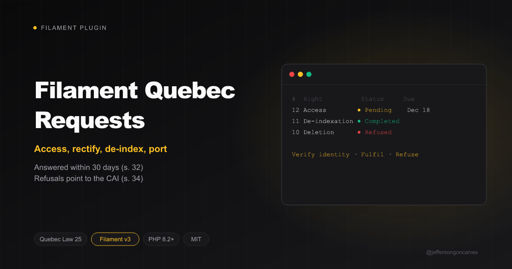

<div class="filament-hidden">



</div>

# Filament Quebec Requests

[](https://packagist.org/packages/jeffersongoncalves/filament-quebec-requests)
[](https://github.com/jeffersongoncalves/filament-quebec-requests/actions?query=workflow%3Atests+branch%3A1.x)
[](https://github.com/jeffersongoncalves/filament-quebec-requests/actions?query=workflow%3A"Fix+PHP+code+styling"+branch%3A1.x)
[](https://packagist.org/packages/jeffersongoncalves/filament-quebec-requests)
[](LICENSE.md)

A Filament panel for requests under Quebec's private sector privacy act (Law 25). It is the UI of [laravel-quebec-requests](https://github.com/jeffersongoncalves/laravel-quebec-requests): every action calls that package, so the rules it enforces (verify first, automatic types only, 30-day deadline) stay in one place.

## Features

- Register a request for access or portability (s. 27), rectification or deletion (s. 28), de-indexation (s. 28.1) or the information behind an automated decision (s. 12.1). The deadline is 30 days from `quebec-requests.deadline`: an unanswered request is deemed refused (s. 32).
- **Verify identity:** link the request to the person's record. Nothing is exported or deleted before this.
- **Fulfil** access and portability (JSON export, a structured, commonly used format, downloadable from the request) and deletion (anonymizes the person's records).
- **Complete** the rights answered by hand with the written answer you gave, or **refuse** with the reasons and the provision relied on; the person may apply to the Commission d'accès à l'information within 30 days (s. 34).
- **Extend** only shows up when you set `quebec-requests.extension`: the private sector act has no extension.
- Overdue requests in red, an "Overdue" filter, and a navigation badge with open requests (red when one is overdue).
- 19 languages.

## Compatibility

| Plugin Version                                                          | Filament |
|-------------------------------------------------------------------------|----------|
| [1.x](https://github.com/jeffersongoncalves/filament-quebec-requests/tree/1.x) | 3.x      |
| [2.x](https://github.com/jeffersongoncalves/filament-quebec-requests/tree/2.x) | 4.x      |
| [3.x](https://github.com/jeffersongoncalves/filament-quebec-requests/tree/3.x) | 5.x      |

## Installation

You can install the package via composer:

```bash
composer require jeffersongoncalves/filament-quebec-requests:"^1.0"
php artisan vendor:publish --tag="quebec-requests-migrations"
php artisan migrate
```

Set up [laravel-quebec](https://github.com/jeffersongoncalves/laravel-quebec) first: the models listed in `quebec.models` are the ones a request can be linked to, exported and erased.

## Usage

```php
use JeffersonGoncalves\Filament\QuebecRequests\QuebecRequestsPlugin;

public function panel(Panel $panel): Panel
{
    return $panel
        ->plugins([
            QuebecRequestsPlugin::make()
                ->navigationGroup('Quebec')                 // default: no group
                ->navigationSort(10)
                ->navigationIcon('heroicon-o-shield-check')
                ->slug('privacy-requests')
                ->subjectModels([User::class]),           // default: quebec.models
        ]);
}
```

All fluent methods are optional. The export disk and the deadline are configured in laravel-quebec-requests's `quebec-requests` config. Keep the export disk private: the file holds the person's personal information.

> The resource has no authorization of its own: register it only on panels whose users handle privacy requests, or add a policy for `JeffersonGoncalves\QuebecRequests\Models\PrivacyRequest`.

## Testing

```bash
composer test
```

## Changelog

Please see [CHANGELOG](CHANGELOG.md) for more information on what has changed recently.

## Contributing

Please see [CONTRIBUTING](.github/CONTRIBUTING.md) for details.

## Security Vulnerabilities

Please review [our security policy](../../security/policy) on how to report security vulnerabilities.

## Credits

- [Jefferson Gonçalves](https://github.com/jeffersongoncalves)
- [All Contributors](../../contributors)

## License

The MIT License (MIT). Please see [License File](LICENSE.md) for more information.
